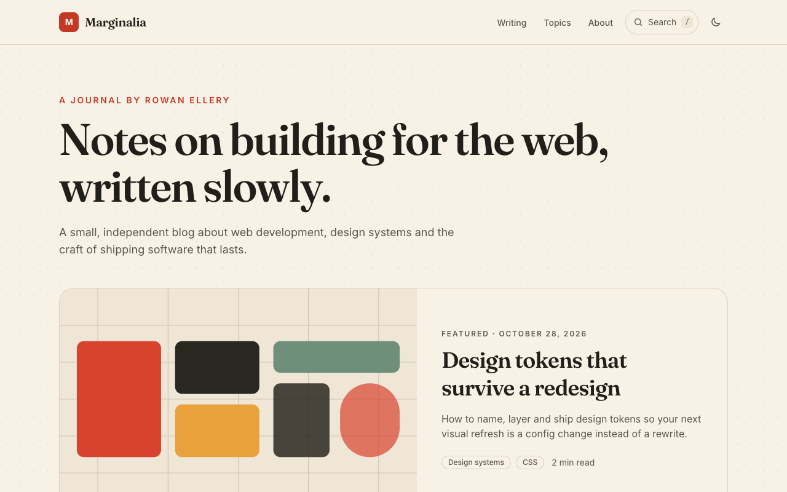

# Marginalia: Next.js blog template

A fast, static Next.js blog starter with MDX posts, tags, search, RSS, social cards and dark mode.



[](https://console.cloudzyro.com/new?repo=https://github.com/Cloudzyro/template-blog)

## What's included

- MDX posts with frontmatter (`title`, `date`, `description`, `tags`, `cover`, `coverAlt`, `featured`)
- Home page with a featured post, recent writing, topics and an author card
- Tag index and a page per tag
- About page with the author bio
- Reading time on every post
- Code blocks highlighted at build time with Shiki (light and dark themes), file titles and a copy button
- Client-side search over titles and tags (press `/` or Ctrl+K)
- RSS feed (`/rss.xml`), sitemap (`/sitemap.xml`) and `robots.txt` generated at build
- Per-post Open Graph and Twitter metadata, with a 1200x630 PNG social card rendered for every post at build
- Newsletter sign-up that posts to a form service of your choice, with an email fallback
- Dark mode that follows the visitor's system setting and remembers their choice
- Fully static output (`out/`), so it runs on any static host
- Accessible: semantic HTML, skip link, visible focus, reduced motion respected

## Run it locally

```bash
pnpm install
pnpm dev        # http://localhost:3000
pnpm build      # static site in out/
pnpm start      # serve the built site
```

## Make it yours

- **Blog name, author, bio, menu and links:** `content/site.ts`
- **Posts:** add `.mdx` files to `content/posts/`. The file name becomes the address (`content/posts/hello.mdx` is `/posts/hello/`). Copy the frontmatter from an existing post. Set `featured: true` on the post you want at the top of the home page.
- **Cover images:** put them in `public/covers/` and point `cover` at them. Always fill in `coverAlt`.
- **Site address:** set `NEXT_PUBLIC_SITE_URL` (for example `https://yourblog.com`) so RSS, the sitemap and social cards use full addresses.
- **Newsletter form:** set `NEXT_PUBLIC_FORM_ENDPOINT` to an address that accepts form posts, such as a Formspree, Basin or Supabase function URL. The form sends one field, `email`. With no endpoint set, the form shows a friendly note and an email link to the address in `content/site.ts`.
- **Colors and fonts:** colors are in the `@theme` block of `app/globals.css`; fonts are loaded with `next/font` in `app/layout.tsx` (Fraunces, Inter and JetBrains Mono).
- **Code themes:** change `theme` in `lib/mdx.tsx` to any Shiki theme.
- **Social cards:** the design is in `app/og/[slug]/route.tsx`.

Environment variables are read at build time, so rebuild after changing them.

| Variable | Required | What it does |
| --- | --- | --- |
| `NEXT_PUBLIC_SITE_URL` | Recommended | Your public address, used in RSS, sitemap and social cards |
| `NEXT_PUBLIC_FORM_ENDPOINT` | Optional | Where the newsletter form posts |

## Deploy

Click the **Deploy to Cloudzyro** button above, or push your own copy to GitHub and connect it in the Cloudzyro console. The build command is `pnpm build` and the output folder is `out`. No server is needed.

## Stack

- [Next.js](https://nextjs.org) 16 with static export
- [MDX](https://mdxjs.com) through `next-mdx-remote`
- [Tailwind CSS](https://tailwindcss.com) 4
- [Shiki](https://shiki.style) and `rehype-pretty-code` for syntax highlighting
- TypeScript

## License

MIT, see [LICENSE](./LICENSE).
